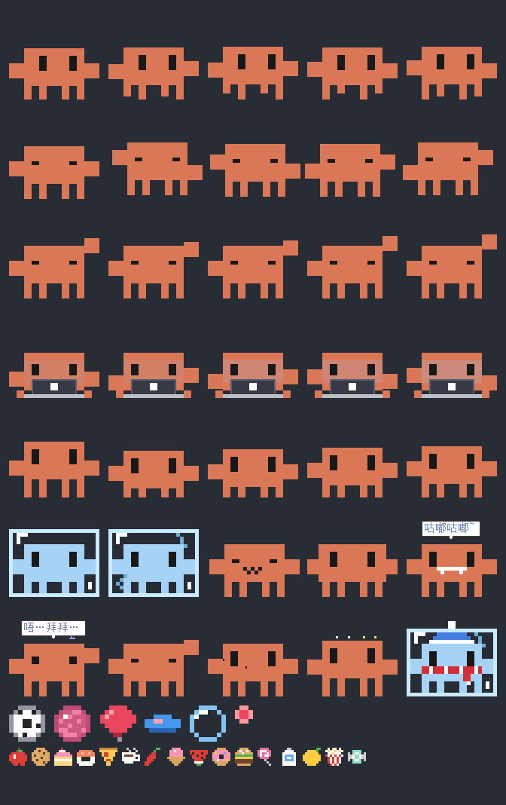
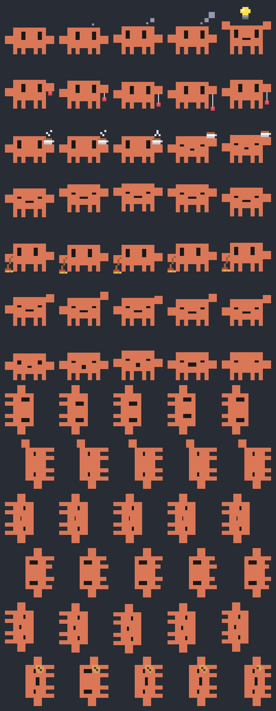
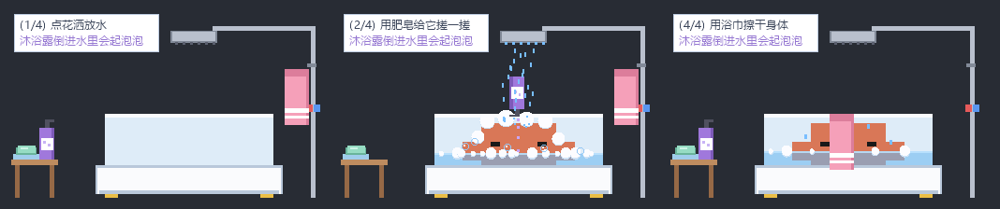
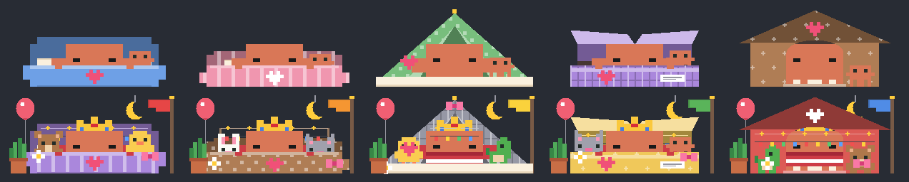
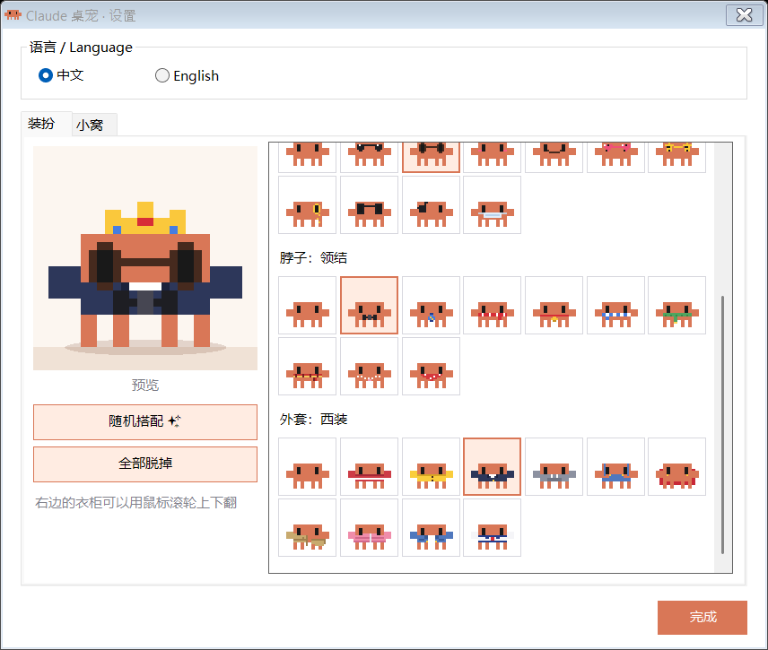

# Claude 桌宠 / Claude Desktop Pet

一只会在你桌面上走来走去的像素小 Claude。免费、开源、双击就能玩。

A little pixel Claude that lives on your Windows desktop. Free, open source, just double-click to play.

## 下载 / Download

到右边的 **[Releases](../../releases/latest)** 下载 `ClaudeDeskTopPet.exe`（或 `ClaudeDeskTopPet-2.0.0.zip`），双击就能运行，不需要安装任何东西。

Grab `ClaudeDeskTopPet.exe` (or the zip) from **[Releases](../../releases/latest)** and double-click it. Nothing to install.

- 运行环境：Windows 10 / 11（系统自带的 .NET Framework 4.x 就够了）
- 第一次打开如果出现「Windows 已保护你的电脑」：点「更多信息」→「仍要运行」（exe 没有数字签名）

## 能做的事 / Features

- **基本操作**：左键点它跳一下；拖动能拎起来，拖到屏幕左右边缘会吸在墙上；右键打开菜单
- **摸头**：鼠标在它头上左右来回蹭就是摸头，它边走边被摸也会脸红冒爱心
- **待机小动作**：想一想、溜溜球、喝热茶、蹦蹦跳跳、扫地、打招呼、打喷嚏……扒在墙上时也会挥手、打盹、晃腿、哼歌、偷吃饼干
- **喂食**：36 种食物，分主食 / 小吃 / 甜点 / 水果 / 饮料，每种吃法都不一样（咖啡是喝的、面条用筷子嗦、薯条一根一根吃、龙虾一口吞）；还能配一份最多 3 样的套餐，它会坐下来慢慢吃
- **玩游戏**：踢足球、毛线球、顶气球、扔飞盘、戳泡泡、激光笔
- **洗澡**：花洒放水 → 肥皂搓澡 → 冲干净 → 浴巾擦干，沐浴露倒进水里会起泡泡
- **装扮**：帽子、眼镜、围巾、外套，几十件随意搭配
- **小窝**：5 种窝、8 种颜色、5 种花纹、9 种装饰、玩偶；在窝里会敲代码、吃零食、看书、打游戏、看电影（猜猜是什么片）、听歌，困了就睡
- **背景和灯光**：温馨小屋 / 草地 / 星空背景，窗外会下雨、打雷、下雪；夜里小窝会发暖光，落地灯可以点开关
- **惊喜**：每小时有 30% 的概率给你送一份小礼物，点一下可以拆开
- **双语**：中文 / English

## 设置 / Settings

右键 →「设置」可以换装扮、改小窝、切换语言。存档在 `%APPDATA%\ClaudePet\config.txt`。
卸载：删掉 exe，再删掉 `%APPDATA%\ClaudePet` 文件夹即可。

## 从源代码编译 / Build from source

打开 `源代码` 文件夹，双击 `build.bat`，会在上一层生成 `ClaudeDeskTopPet.exe`。
用的是 Windows 自带的 C# 编译器，不需要安装 Visual Studio。

Open the `源代码` folder and double-click `build.bat`. It uses the C# compiler that ships with Windows.

## 说明 / Note

这是粉丝自制的非官方同人作品，与 Anthropic 无关。完全免费、开源，做着玩的，欢迎随意游玩和分享。
“Claude”名称及其形象归 Anthropic 所有。

Unofficial fan-made project (fan work), not affiliated with Anthropic. Completely free and open source — made just for fun.
"Claude" and its character belong to Anthropic.

## 许可证 / License

本项目代码以 **[GPL-3.0](LICENSE)** 发布：可以自由使用、修改和分享，但修改后再发布的版本也必须以 GPL-3.0 开源。

The code is licensed under **[GPL-3.0](LICENSE)**: free to use, modify and share, but any modified version you distribute must also be open source under GPL-3.0.

---

By 雷茂教主Ray5Green
